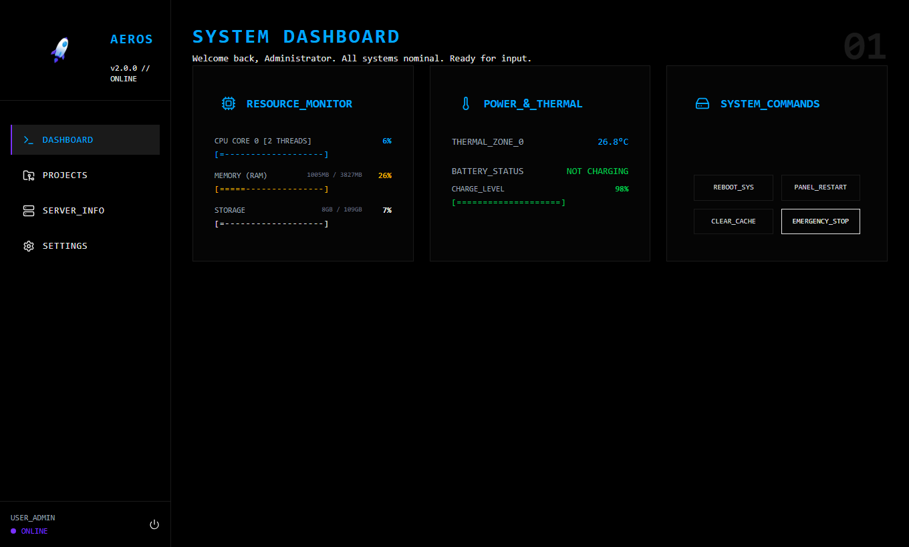
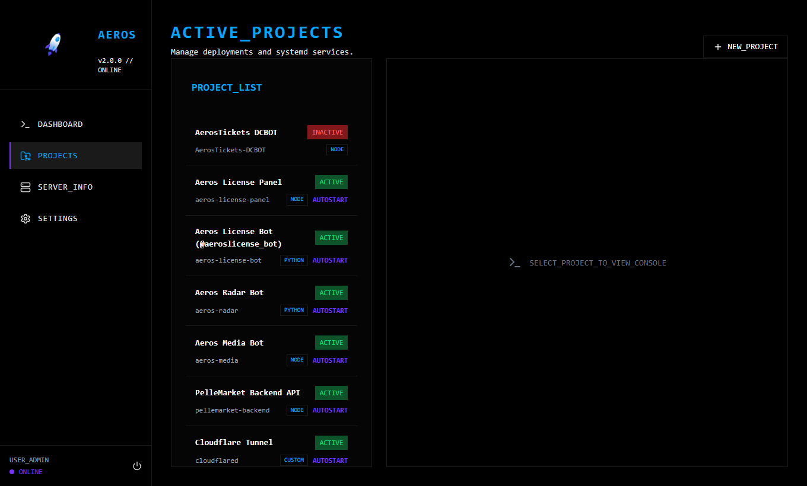
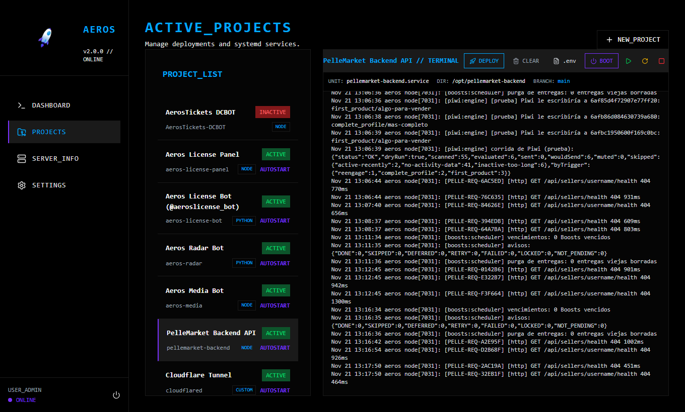
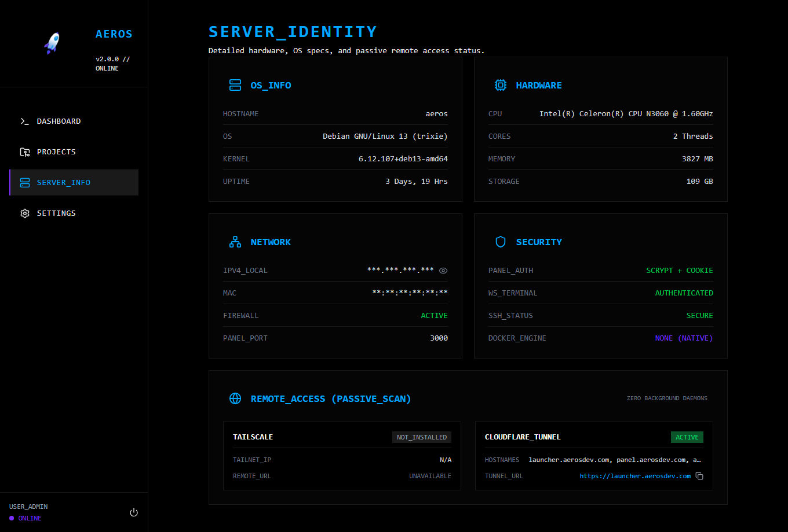
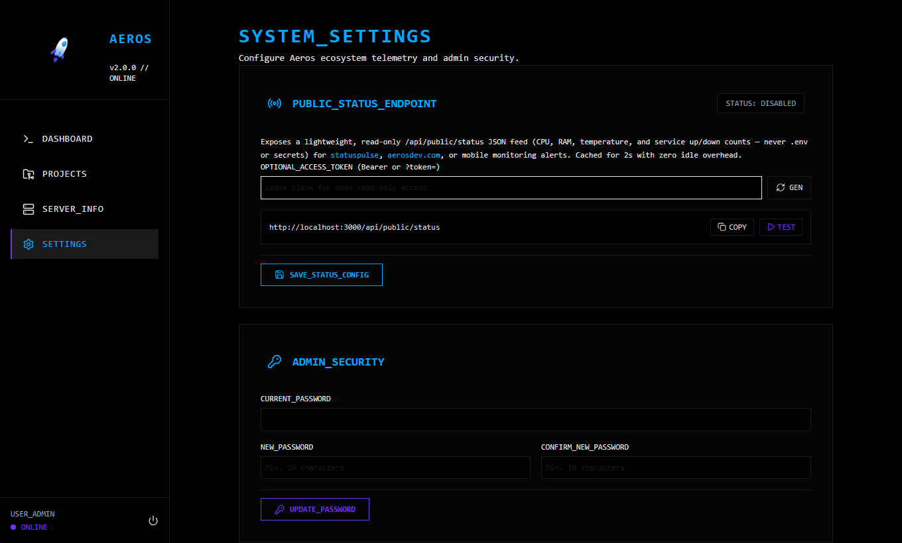

# AerosPanel

> **Turn your old PC (even a Celeron) into a real self-hosted server — without Docker eating your RAM.**

A zero-overhead, native Linux control panel designed for low-resource hardware, mini PCs, old laptops, and lean Debian/Ubuntu VPS nodes. Instead of running Docker daemons, reverse proxies, and background containers, **AerosPanel** runs as a single Node.js process that talks directly to Linux `/sys/class/` sensors, `systemctl`, and `journalctl` — leaving **0% extra overhead when idle**.

---

## Screenshots







---

## Why AerosPanel? (Real Measured Idle Footprint)

| Feature | **AerosPanel (measured)** | Docker + Portainer | Coolify | Pterodactyl |
| :--- | :--- | :--- | :--- | :--- |
| **Idle RAM** | **27.1 MB** cgroup (`~61 MB` total RSS, 1 process) | ~250–450 MB (`dockerd` + container) | ~1.5–2.5 GB+ (Docker + DB + proxy) | ~600 MB–1.2 GB (Panel + Wings + DB + Redis) |
| **Docker Required** | **No (Zero Docker)** | Yes | Yes | Yes |
| **Background Polling Daemons** | **None (on-demand only)** | Yes | Yes | Yes |
| **Native `systemd` Services** | **Yes (1-click templates)** | No | No | No |
| **Hardware Sensors (`/sys/class/`)** | **Native (CPU, RAM, Temp, Battery)** | External agent | Limited | No |
| **1-Click Git Deploy + Live Logs** | **Yes (WebSocket terminal)** | Manual / GitOps add-on | Yes | Manual |
| **Ideal Hardware** | **Old Celeron, 2–4 GB RAM laptop, small VPS** | Mid-range homelab | 4+ GB RAM VPS | Dedicated game server |

> **Real measurement:** Tested on an **Intel Celeron N3060 @ 1.60GHz** (4 GB RAM, Debian 13 trixie, Node.js v20, managing 8 `systemd` services): `systemctl status aeros-panel` reports **27.1 MB** idle cgroup memory (peak **34.7 MB**, 11 tasks, 1 process), `RssAnon` **17.8 MB**, and `ps` total RSS **61 MB** (including shared Node binary pages). Verify on your own machine anytime with `systemctl status aeros-panel`.

---

## Quick Install (Debian / Ubuntu)

Install and start AerosPanel as a single `systemd` service in one command:

```bash
curl -fsSL https://raw.githubusercontent.com/DevModee/Aeros-Panel/main/scripts/install.sh | sudo bash
```

Or from a local clone:

```bash
sudo ./scripts/install.sh
```

What the installer does:
1. Installs prerequisites and Node.js 22 LTS (if not already present).
2. Builds `frontend` into static files served directly by the Express backend (no Vite dev server in production).
3. Generates a random initial admin password, hashes it with Node's native `scrypt` into SQLite (`aeros.db`), and prints it once at the end.
4. Installs and enables `/etc/systemd/system/aeros-panel.service` with a `MemoryMax=256M` guardrail.

Optional environment overrides:

```bash
AEROS_PORT=8080 AEROS_DIR=/opt/aeros-panel AEROS_MEMORY_MAX=256M sudo -E ./scripts/install.sh
```

Reset your admin password from SSH at any time:

```bash
node /opt/aeros-panel/backend/dist/seed.js admin your-new-password
```

---

## Features

- **Single-Process Production Architecture**: Express serves both the API, authenticated WebSocket log stream, and prebuilt React static assets (`frontend/dist`) from one lightweight process.
- **Lightweight Session Auth**: Built-in admin login using Node's native `crypto.scrypt` + `HttpOnly` `SameSite=Lax` session cookies stored in SQLite. Protects all REST endpoints and the WebSocket terminal with zero heavy auth frameworks.
- **1-Click `systemd` Templates**: Create services from ready-made templates (`Node.js / TypeScript`, `Python (FastAPI / Bot)`, `Static / Vite`, `Java / Minecraft`, or `Custom Command`) with `Restart=always`, optional `MemoryMax=`, optional Linux `User=` isolation, and live `.service` preview.
- **1-Click `Deploy / Update`**: Runs `git pull` (or initial `git clone`), installs dependencies only when lockfiles change, executes your build command if configured, and restarts the `systemd` unit — streaming every line live to the built-in WebSocket terminal.
- **Native Hardware Telemetry**: Reads CPU, RAM, storage, thermal zones, and laptop battery status directly from Linux `/sys/class/` and OS syscalls.
- **Passive Remote Access Detection**: Checks on demand (zero background daemons) whether **Tailscale** or **Cloudflare Tunnel (`cloudflared`)** is active on the host and displays your remote panel URL in `Server Info`.
- **`.env` File Editor**: Edit environment variables directly from the UI and persist them to `<work_dir>/.env`.
- **Optional Aeros Ecosystem Status Feed (`/api/public/status`)**: Disabled by default. Toggle it on from `Settings` (with optional Bearer/`?token=` protection) to expose read-only host metrics and service `up/down` counts to **statuspulse**, **aerosdev.com**, or mobile alert clients.

### Example `/api/public/status` Response

```json
{
  "status": "operational",
  "timestamp": "2026-11-21T18:00:00.000Z",
  "panel": { "name": "AerosPanel", "version": "2.0.0" },
  "host": { "hostname": "celeron-homelab", "uptime": 412800 },
  "metrics": {
    "cpuPercent": 4,
    "memoryPercent": 19.2,
    "memoryUsedMb": 786,
    "memoryTotalMb": 4096,
    "storagePercent": 28.4,
    "temperatureC": 43.5
  },
  "services": {
    "total": 3,
    "up": 3,
    "down": 0,
    "items": [
      { "name": "Discord Bot", "service_name": "discord-bot", "status": "active" }
    ]
  }
}
```

---

## Tech Stack

- **Frontend**: React 19, TypeScript, Vite, Tailwind CSS v4, Terminal.css, Lucide React.
- **Backend**: Node.js, Express 5, TypeScript, SQLite3 (Knex), `ws`, native `crypto.scrypt`, native `systemctl` & `journalctl`.

---

## Local Development

### 1. Backend
```bash
cd backend
npm install
npm run dev
```

### 2. Frontend (with Vite proxy to `/api` and `/ws`)
```bash
cd frontend
npm install
npm run dev
```

### 3. Single-Process Production Build
```bash
cd frontend && npm ci && npm run build
cd ../backend && npm ci && npm run build && npm start
```

On first visit to `http://localhost:3000`, if no admin user exists yet, AerosPanel automatically opens the **Initial Admin Setup** screen.

---

## License

Released under the [MIT License](LICENSE).
